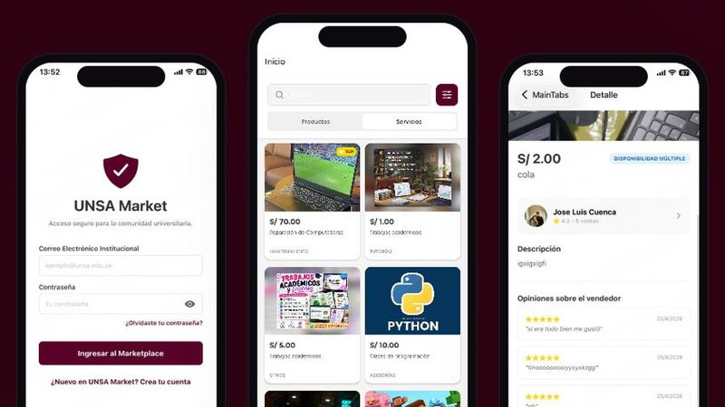
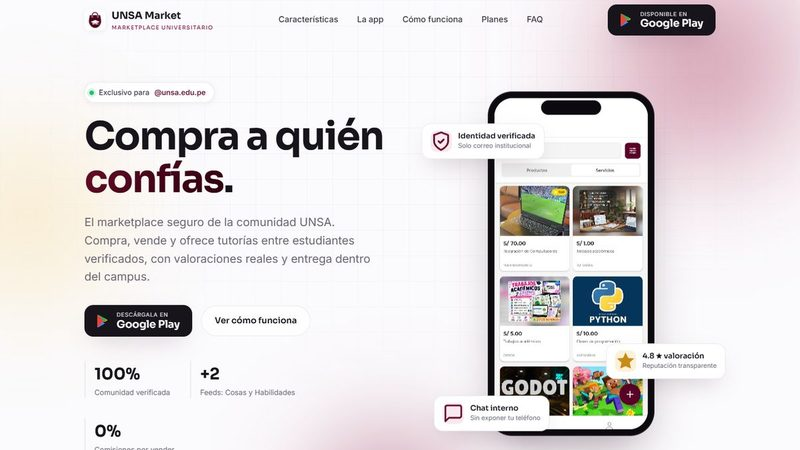
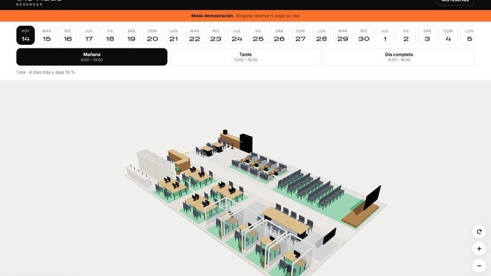
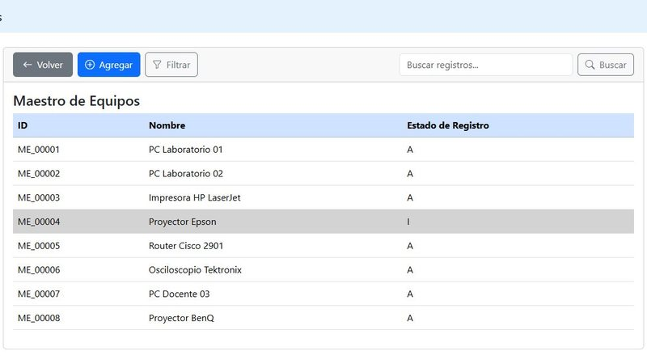
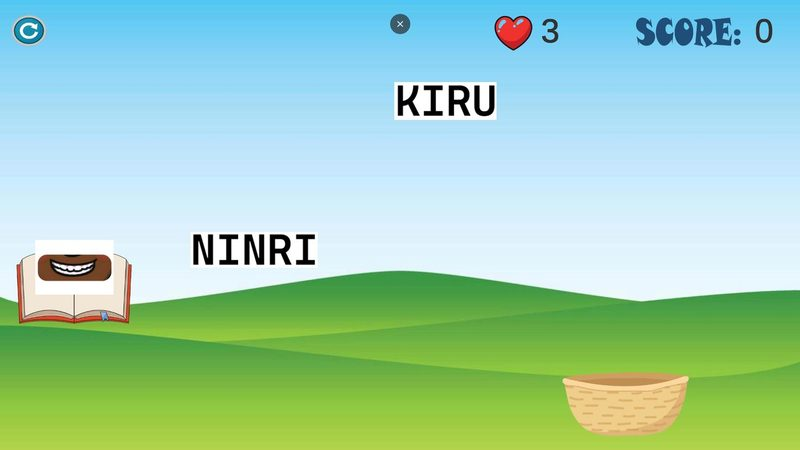
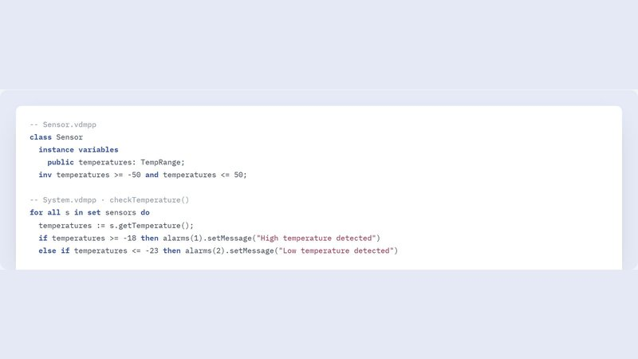

# José Luis Cuenca Gutiérrez

Estudio Ingeniería de Sistemas en la UNSA, en Arequipa. Programo sobre todo aplicaciones web y móviles, y algún juego cuando el curso lo pide. Ahora estoy con la tesis: un juego en Phaser que evalúa conceptos básicos en niños de 5 años a partir del movimiento del ratón y la expresión facial.

[Portafolio](https://portafolio-jlcg.vercel.app/) · [LinkedIn](https://www.linkedin.com/in/josecuencag) · [Servicios freelance](https://portafoliofreelance-jlcg.vercel.app/)

## Algunos proyectos

<table>
<tr>
<td width="50%" valign="top">

<h3>UNSA Market</h3>

App Android para comprar y vender entre estudiantes de la UNSA. Se entra con el correo institucional y cada vendedor tiene reseñas. Fui el desarrollador principal en un equipo de cuatro.

React Native · Expo · TypeScript · Firebase

<a href="https://play.google.com/store/apps/details?id=com.unsa.market">Google Play</a> · <a href="https://github.com/JCuenca17/unsa-market">Código</a>

</td>
<td width="50%" valign="top">

<h3>Landing de UNSA Market</h3>

La página que presenta la app y lleva a la descarga. Hecha con HTML, CSS y JavaScript, sin frameworks.

HTML · CSS · JavaScript · Vercel

<a href="https://unsamarket.vercel.app/">Ver sitio</a> · <a href="https://github.com/JCuenca17/landing-unsa">Código</a>

</td>
</tr>
<tr>
<td width="50%" valign="top">

<h3>The Haus</h3>

Landing y app de reservas para un coworking que unos estudiantes de Administración plantearon como proyecto final. Los puestos se eligen sobre un plano 3D del local.

JavaScript · three.js · PWA

<a href="https://thehaus-pink.vercel.app/app/">Probar el plano</a> · <a href="https://github.com/JCuenca17/thehaus">Código</a>

</td>
<td width="50%" valign="top">

<h3>Maestro de Equipos</h3>

Inventario de equipos de laboratorio en Django, con login, búsqueda, filtros, borrado lógico y versión instalable como PWA.

Python · Django · MySQL · Bootstrap

<a href="https://github.com/JCuenca17/lab_ne">Código</a>

</td>
</tr>
<tr>
<td width="50%" valign="top">

<h3>Yachay</h3>

Juego para aprender palabras en quechua. Sale una pista en español y hay que atrapar la traducción con una canasta. Se juega en el navegador.

Unity · C#

<a href="https://abduzcan17.itch.io/yachay">Jugar en itch.io</a> · <a href="https://github.com/JCuenca17/yachay">Código</a>

</td>
<td width="50%" valign="top">

<h3>Monitoreo de temperatura</h3>

Especificación formal en VDM++ de las alarmas de un almacén de congelados, validada en VDM Toolbox. Fue parte de un artículo del curso.

VDM++ · UML

<a href="https://github.com/JCuenca17/proyecto1-afev">Código</a>

</td>
</tr>
</table>

## Otros repos

- [proyecto-cultivos](https://github.com/JCuenca17/proyecto-cultivos): predice la demanda de palta, mango y arándanos con datos históricos y la ajusta según el clima. Flask y pandas.
- [app-finanzas](https://github.com/JCuenca17/app-finanzas): finanzas personales con cuentas, deudas, pagos fijos y gráficos. Vue 3, Tailwind y Supabase, con backend en FastAPI.
- [sd-final](https://github.com/JCuenca17/sd-final): tienda distribuida en dos nodos con FastAPI y SQLAlchemy.
- [mi-portafolio-react](https://github.com/JCuenca17/mi-portafolio-react): portafolio de una sola página en React y Vite.
- [ps_final](https://github.com/JCuenca17/ps_final): alquiler de películas por consola, en C++.
- [LAB_SD](https://github.com/JCuenca17/LAB_SD): laboratorios de Sistemas Distribuidos en Java (RMI, XML, JAX-RS).
- [lab03-clima-kiro](https://github.com/JCuenca17/lab03-clima-kiro): app del clima en TypeScript, con tests.

## Con qué trabajo

JavaScript, TypeScript y Python son lo que más uso. Para web y móvil he trabajado con React, Vue, React Native y Expo, Django, Flask, FastAPI, Firebase y Supabase, y despliego en Vercel. En juegos uso Phaser 3 y Unity con C#. También he programado en Java y C++, y he usado MySQL, PostgreSQL y scikit-learn.

## Certificaciones

- Programa Oracle Next Education, Oracle y Alura Latam, 2023 ([verificar](https://app.aluracursos.com/program/certificate/575298e0-5813-4d18-9435-24331dc15a59))
- Formación HTML & CSS, Alura Latam, 2023 ([verificar](https://app.aluracursos.com/degree/certificate/c618d520-2b28-4ed2-944e-40aafde21c06))
- Front-End Web UI Frameworks and Tools: Bootstrap 4, HKUST en Coursera, 2021 ([verificar](https://coursera.org/verify/UT3C8MRP9BM8))
